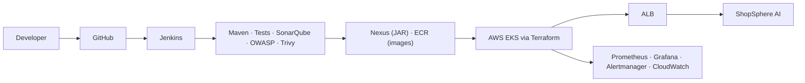

# ShopSphere AI

**AI-enabled e-commerce application with a complete industrial DevOps, DevSecOps, AWS, Kubernetes,
CI/CD, infrastructure-automation and observability platform.**

> Training and portfolio project by [@rahmanuddinmd](https://github.com/rahmanuddinmd).



## What's inside
| Area | Implementation |
|---|---|
| Shop | Register/login (JWT), catalog with search & filters, product pages with photos, cart, checkout, order history, profile |
| Admin | Dashboard (KPIs, low stock, system health), product CRUD, order status management |
| AI | **ShopSphere AI Assistant** answers from live catalog data; **AI DevOps Assistant** diagnoses pipeline/cluster logs (secrets redacted, never executes commands). `AI_PROVIDER=ollama \| bedrock \| disabled` |
| Backend | Java 21, Spring Boot 4.1, Spring Security (JWT, RBAC), JPA, Flyway, Actuator, Micrometer |
| Frontend | React 19, React Router 7, Vite, Vitest |
| Data | PostgreSQL 17 (StatefulSet on EKS, optional RDS) |
| Containers | Multi-stage, non-root Dockerfiles; Compose profiles `app`, `ai`, `ci`, `monitoring` |
| CI/CD | Jenkins (primary), GitHub Actions (PR checks), SonarQube, Nexus, Trivy, OWASP Dependency-Check |
| Cloud | Terraform: S3 state (native locking), VPC, ECR, EKS + add-ons, IAM/Pod Identity, RDS, budgets, CI server EC2 |
| Configuration management | Ansible roles `common`, `docker`, `shopsphere_ci` provision the Jenkins/SonarQube/Nexus server; optional Jenkins Configuration-as-Code |
| Kubernetes | kustomize base + overlays (local/dev/staging/prod), probes, limits, HPA, PDB, ALB Ingress |
| Observability | Prometheus, Grafana dashboards, Alertmanager (+Mailpit), kube-prometheus-stack, CloudWatch, optional Loki |

## Quick start (local, ~5 minutes)
```bash
git clone https://github.com/rahmanuddinmd/shopsphere-ai-devops.git
cd shopsphere-ai-devops
bash scripts/install-tools.sh               # Ubuntu/WSL: installs Docker, JDK 21, Node, AWS CLI, Terraform, kubectl, Helm, Trivy, Ansible
bash scripts/setup.sh                       # verifies your tools
cp .env.example .env                        # fill in the <CHANGE_ME> values
openssl rand -base64 64 | tr -d '\n'        # -> JWT_SECRET in .env
docker compose --profile app up -d --build
bash scripts/health-check.sh local
```
Open **http://localhost:3000** and sign in with `ADMIN_EMAIL` / `ADMIN_PASSWORD` from `.env`.

## Guides
| Goal | Document |
|---|---|
| **Complete deployment, start to finish** | [docs/DEPLOYMENT_RUNBOOK.md](docs/DEPLOYMENT_RUNBOOK.md) |
| Install every tool (Windows/WSL, Ubuntu, macOS) | [docs/INSTALLATION.md](docs/INSTALLATION.md) |
| CI server with Terraform + Ansible | [docs/deployment/ci-server.md](docs/deployment/ci-server.md) |
| Understand the application & API | [docs/architecture/application.md](docs/architecture/application.md) |
| Architecture decisions & components | [docs/architecture/architecture.md](docs/architecture/architecture.md) · [diagrams/](diagrams/) |
| Names, ports, env vars (single source of truth) | [docs/architecture/conventions.md](docs/architecture/conventions.md) |
| Run locally / with Docker | [docs/deployment/local.md](docs/deployment/local.md) · [docs/deployment/docker.md](docs/deployment/docker.md) |
| Kubernetes locally (free) | [docs/deployment/kubernetes-local.md](docs/deployment/kubernetes-local.md) · [docs/kubernetes/kubernetes.md](docs/kubernetes/kubernetes.md) |
| Deploy to AWS EKS | [docs/deployment/aws.md](docs/deployment/aws.md) · [docs/deployment/eks.md](docs/deployment/eks.md) |
| Jenkins, SonarQube, Nexus, Git | [docs/devops/](docs/devops/) |
| Security scanning | [docs/security/trivy.md](docs/security/trivy.md) · [docs/security/owasp.md](docs/security/owasp.md) · [SECURITY.md](SECURITY.md) |
| Monitoring | [docs/monitoring/](docs/monitoring/) |
| AI | [docs/ai/AI_GUIDE.md](docs/ai/AI_GUIDE.md) |
| AWS costs & cleanup | [docs/aws/AWS_COST_GUIDE.md](docs/aws/AWS_COST_GUIDE.md) |
| Troubleshooting & failure drills | [docs/troubleshooting/troubleshooting.md](docs/troubleshooting/troubleshooting.md) |
| Command center (URLs, ports, health checks) | [docs/PROJECT_DASHBOARD.md](docs/PROJECT_DASHBOARD.md) |
| Training roadmap / interview prep | [docs/training/roadmap.md](docs/training/roadmap.md) · [docs/interview/INTERVIEW_GUIDE.md](docs/interview/INTERVIEW_GUIDE.md) |

## Repository layout
```text
backend/        Spring Boot API (com.shopsphere), Dockerfile, Maven wrapper, tests
frontend/       React app, Nginx template, Dockerfile, tests, product images
kubernetes/     base/ components/aws-alb/ overlays/{local,dev,staging,prod}/ monitoring/
terraform/      bootstrap/ environments/{dev,staging,prod,tooling}/ modules/{vpc,ecr,eks,iam,rds,security-groups,monitoring}
ansible/        playbooks/ci-server.yml, roles/{common,docker,shopsphere_ci}, inventory example
jenkins/        Jenkins image, plugins, Configuration-as-Code, Maven settings, deploy & smoke-test scripts (Jenkinsfile at root)
monitoring/     Prometheus, Alertmanager, Grafana provisioning + dashboards, kube-prometheus-stack values, Loki
security/       Trivy config/ignore, Dependency-Check suppressions
sonarqube/ nexus/ database/ postman/ scripts/ docs/ diagrams/ .github/
```

## ⚠️ AWS cost warning
EKS, NAT Gateway, ALB and EC2 bill by the hour (~$0.30-0.40/h for the DEV stack). Finish every AWS
session with `bash scripts/aws-cleanup.sh`.

## License
[MIT](LICENSE)
