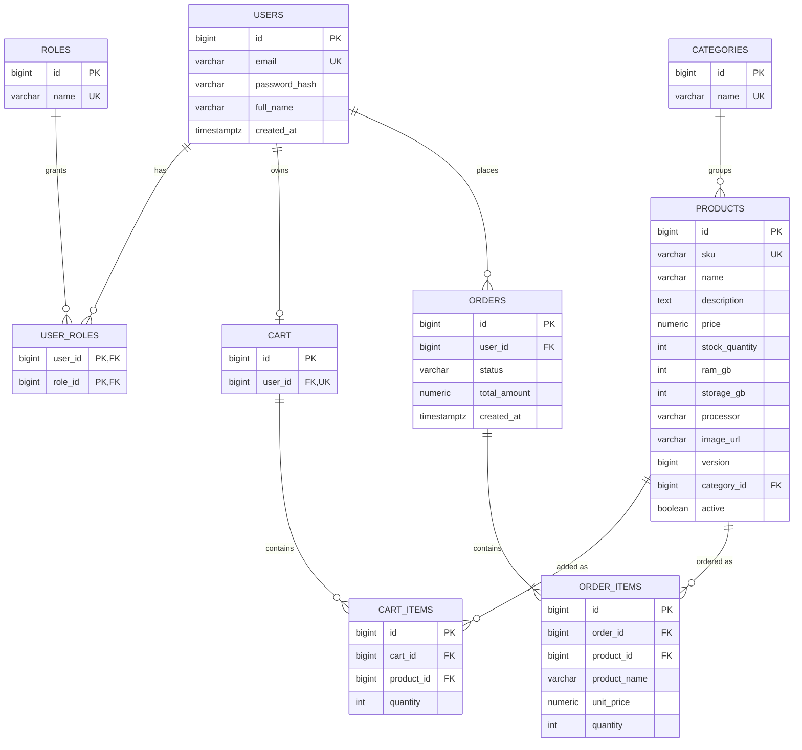

# 05 — Database Architecture (PostgreSQL `shopsphere`, Flyway-managed)

Design notes: `order_items` snapshots `product_name` and `unit_price` so order history does
not change when a product price changes later. Structured spec columns (`ram_gb`, `storage_gb`,
`processor`, `display`) let SQL and the AI assistant filter on RAM and price; `version` enables
optimistic locking at checkout. Passwords are stored only as BCrypt hashes.
