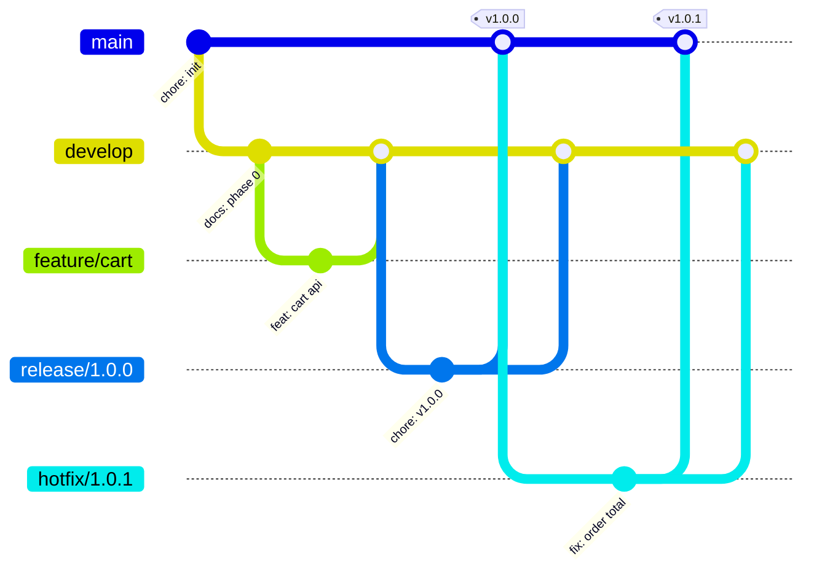

# 06 — Git Workflow

| Branch | Created from | Merged into | Deploys to |
|---|---|---|---|
| `feature/*` | develop | develop (PR) | — |
| `develop` | main | — | DEV (automatic) |
| `release/*` | develop | main + develop | STAGING |
| `main` | — | — | PROD (approval) |
| `hotfix/*` | main | main + develop | PROD (approval) |
