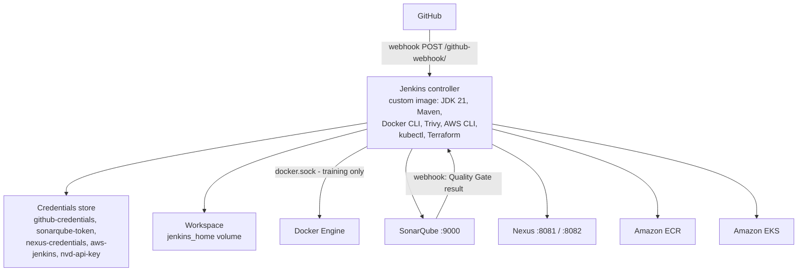

# 07 — Jenkins Architecture

Trade-off: mounting `/var/run/docker.sock` gives Jenkins root-equivalent access to the host.
Acceptable on a single-user training VM; in production use dedicated build agents,
Kaniko/BuildKit, or ephemeral Kubernetes agents.
