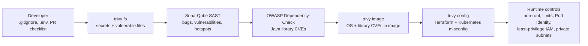

# 10 — DevSecOps Pipeline (shift-left)

| Severity | Pipeline action (initial) |
|---|---|
| CRITICAL (fix available) | Fail |
| HIGH | Warn, report archived; tightened to fail in hardening phase |
| MEDIUM / LOW | Report only |
| Accepted risk | `.trivyignore` / suppression XML entry with reason + expiry date |
