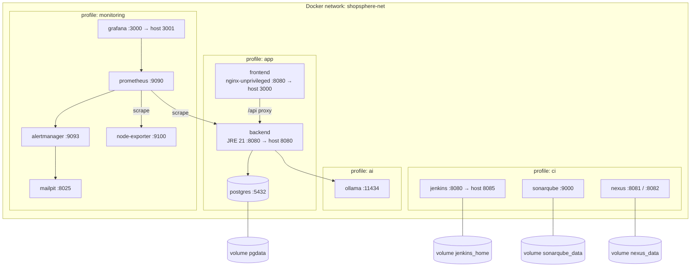

# 11 — Docker / Docker Compose Architecture

Multi-stage builds: backend = Maven/JDK build stage → JRE runtime; frontend = Node build
stage → Nginx runtime. Both run as non-root with a HEALTHCHECK.
